# SignFlow

[](https://github.com/Huseyinyagmur/signflow/actions/workflows/ci.yml)

**Canlı uygulama:** [signflow-k2tg.onrender.com](https://signflow-k2tg.onrender.com/) · **GitHub:** [Huseyinyagmur/signflow](https://github.com/Huseyinyagmur/signflow)

Ruby 3.4.11 / Rails 8.1.4, ERB, Hotwire (Turbo/Stimulus), Tailwind CSS ve Minitest ile geliştirilmiş üniversite projesi. Development/test SQLite, production PostgreSQL kullanır ([Gemfile](Gemfile), [veritabanı ayarı](config/database.yml); inceleme: 17.10.2026). Kullanıcı sözleşme oluşturur, güvenli bağlantıyı paylaşır ve alıcının demo imzasını takip eder. Nitelikli elektronik imza veya doğrulanmış kimlik iddiası yoktur. İlham kaynağı DocuSign yalnızca bu README'nin araştırma bağlamında anılır; uygulama markası SignFlow'dur.

**Teslim durumu (17.10.2026):** Yukarıdaki canlı ana sayfa HTTP GET ile 200 döndürdü ve SignFlow metni içerdi. Bu kontrol kayıt/imza akışının tarayıcı testi değildir. Free web ve Free PostgreSQL seçimi kullanıcı beyanıdır; Render hesabı veya faturası incelenmedi. Önceki production hazırlığı raporundaki “deploy yapılmadı” ifadesi o çalışmanın tarihsel sonucudur; bu README aşamasında da deploy veya push yapılmadı.

## Ödev Özeti

| Başlık | Hızlı erişim / sonuç |
| --- | --- |
| Canlı uygulama / kaynak / CI | [Canlı SignFlow](https://signflow-k2tg.onrender.com/) · [GitHub](https://github.com/Huseyinyagmur/signflow) · [Actions ve üstteki CI rozeti](https://github.com/Huseyinyagmur/signflow/actions/workflows/ci.yml) |
| Fortune 500 müşteri kanıtı | Birincil örnek **Comcast Business**: [resmî müşteri vaka çalışması](https://www.docusign.com/sites/default/files/resource_event_files/docusign_case_study-comcast__2.pdf) + [Comcast Fortune profili](https://fortune.com/company/comcast/). Ticari kullanım güçlü; doğrudan ödeme/fatura kanıtı yok. |
| Aort dilimi | [Kayıt → giriş → taslak → gönder → güvenli link → demo imza → signed](#aort-dilimi--çalışan-ana-iş-akışı); durum ve zaman kuralları gerçek dosyalarla bağlantılı. |
| Canlı manuel doğrulama | [Kullanıcı beyanı, 17.10.2026](#canlı-render-manuel-kabul-testleri--kullanıcı-beyanı): oturum 5/5, normal sözleşme 6/6, şablon 8/8; restart sonrası kalıcılık başarılı. Codex otomasyonu değil. |
| Süre / maliyet | [Bildirilen süre ve maliyet](#gerçek-geliştirme-ve-barındırma-maliyeti): yaklaşık 1–2 saat, ayrı API faturası 0 $; abonelik payı bilinmiyor. [İş günü tahmini](#gün-bazlı-geliştirme-süresi--mühendislik-tahmini) ve [varsayımsal API hesabı](#coding-agent-için-varsayımsal-api-maliyeti) ayrı modellerdir. |
| Kullanıcı acısı / çözüm | [Doğrudan açılan TrustRadius yorumu ve korunan Capterra bağlamı](#gerçek-kullanıcı-problemi-ve-çözümümüz): metin şablonları, önizleme ve sürüm geçmişi; PDF koordinatlama çözümü değildir. |
| Eksikler / puan kriterleri | [Yapamadıklarım](#yapamadıklarım) · [0/85/100 teslim eşlemesi](#085100-kısa-teslim-eşlemesi) · [AGENT.md](AGENT.md). Bunlar kesin not iddiası değildir. |

## Render production kurulumu

Development/test SQLite, production PostgreSQL kullanır. Native Ruby build komutu
`bash bin/render-build.sh`, start komutu `bash bin/render-start.sh`, health yolu `/up`.
Build asset/Tailwind derler; start migration sonrası Puma başlatır. Gerekli gizli değişkenler:
`DATABASE_URL`, `RAILS_MASTER_KEY`. Plan seçimi, environment, manuel deploy, migration ve
sorun giderme adımları: [Render rehberi](docs/RENDER_DEPLOYMENT.md).
Otomatik kaynak oluşturan render.yaml yoktur. Rehberde kalıcılık için önerilen ücretli PostgreSQL ile kullanıcının ödev demosunda seçtiğini bildirdiği süreli Free PostgreSQL birbirinden farklıdır; ücretsiz veritabanı süresiz saklama garantisi değildir.

## SignFlow Agent — güvenli API (25.10.2026)

Yerel Aşama 1: kullanıcıya ait sabit şablon sürümünden idempotent taslak oluşturma/sorgulama API'si eklendi. `AGENT_API_ENABLED=true` olmadıkça kapalıdır; agent için gönderim/imza endpoint'i yoktur. Mevcut web oturumu ve CSRF koruması korunur. `script/agent_demo_client.rb` gerçek HTTP davranışını denetleyen **deterministik istemcidir; LLM agent değildir**. LLM entegrasyonu sonraki aşamadadır; Render'a deploy yapılmadı.

Endpoint, kimlik teslimi/iptali, gerçek yerel testler ve sınırlamalar: [Aşama 1 rehberi](docs/AGENT_API_STAGE1.md). [Challenge kaydı](CHALLENGE_LOG.md), [ilk plan](docs/AGENT_FIRST_IMPLEMENTATION_PLAN.md).

## Araştırma yöntemi ve kanıt sınırı

Araştırma/erişim tarihi **17.10.2026**; kapsam **2026 ABD Fortune 500**. Global 500 ve Europe 500 verileri bu listeye karıştırılmaz. Dış veriler kaynaklarıyla, yerel sayımlar ölçüm etiketiyle, kullanıcı bilgileri beyan etiketiyle, varsayımlar tahmin etiketiyle gösterilir. Erişim tarihi, finansal verinin ölçüm tarihi değildir. Dinamik şirket profilleri sonradan değişebilir. Doğrudan erişilemeyen veya tüm listeyi kapsamayan kanıttan kesin minimum çıkarılmaz; eksikler [teslim kontrol tablosunda](#ödev-teslim-kontrol-tablosu) açık kalır.

**Son kanıt denetimi:** Önceki doğrulamalar yeniden sorgulandı. Yeni SEC/yıllık rapor kontrolleri, müşteri karşılaştırması, kaynak konumları, yayın/veri tarihleri ve A–D güvenilirlik tablosu [FINAL_EVIDENCE_AUDIT.md](docs/FINAL_EVIDENCE_AUDIT.md) içindedir. HTTP 200 tek başına içerik doğrulaması sayılmadı; ödeme belgesi ile ticari müşteri vakası ayrı tutuldu.

## Faz 1 — Fortune 500 genel araştırması

### A. Şirket değeri ile yıllık gelir

Fortune 500, şirketleri **yıllık gelire göre** sıralar. Piyasa değeri ise halka açık şirketin hisse fiyatı × dolaşımdaki hisse sayısıdır; yıllık satış tutarı veya enterprise value ile aynı ölçü değildir. ABD listesi ve dönem tanımı için [Fortune sıralaması](https://fortune.com/ranking/fortune500/) (2026; erişim: 17.10.2026).

**Terimler:** Market capitalization, halka açık özsermayenin anlık değeridir ([SEC Investor.gov, Market Capitalization](https://www.investor.gov/introduction-investing/investing-basics/glossary/market-capitalization), yayın tarihi belirtilmiyor; erişim: 17.10.2026). Enterprise value buna borç, imtiyazlı pay ve azınlık paylarını ekleyip nakit/nakit benzerlerini düşüren farklı ölçüdür ([Fidelity, Enterprise Value sözlüğü](https://www.fidelity.com/webcontent/ap010098-etf-content/18.05.0/help/research/learn_er_glossary_1.shtml), yayın tarihi belirtilmiyor; erişim: 17.10.2026). Company valuation genel bir değerleme kavramıdır; özsermaye mi işletme değeri mi olduğu belirtilmelidir. Annual revenue ise belirli dönemin gelir akışıdır. Özel şirketin yatırım turu değerlemesi, tarih/kapsam eşitlenmeden borsa değeriyle aynı veri alanına yazılmaz.

Fortune'un yayımlayıcı duyurusunda listeye giriş gelir eşiği **7,5 milyar $**, gelir lideri Amazon'un geliri **700 milyar $ üzeri** olarak verilir; bunlar değerleme aralığı değildir ([Fortune, 03.06.2026 duyurusu](https://fortunemedia.mediaroom.com/2026-06-03-Amazon-Claims-No-1-Spot-on-the-Fortune-500); 2026 listesi, ilgili mali yıllar; erişim: 17.10.2026).

**Yeni tam liste kontrolü (17.10.2026):** [Resmî 2026 liste sayfasının](https://fortune.com/ranking/fortune500/) herkese açık HTML verisindeki `franchiseSearch.items` kayıtları Python ile incelendi. Yıl **2026**, sıra **1–500** filtresiyle **500 benzersiz şirket** bulundu: üyelik kapsamı **%100**. Piyasa değeri **472 şirkette dolu (%94,4)**, **28 şirkette boş (%5,6)**; boş alanlar sıfır sayılmadı. Özel/mutual şirketler için yapay borsa değeri üretilmedi. Yöntem, eksiklerin listesi ve tekrar hesaplama kodu [kanıt raporunda](docs/FINAL_EVIDENCE_AUDIT.md#13-son-iki-kanıt-için-genişletilmiş-araştırma).

| 2026 liste tablosundaki uç / şirket | ABD sırası | Ticker eşleşmesi | Piyasa değeri | Tarih ve doğrudan dayanak |
| --- | ---: | --- | ---: | --- |
| Minimum — QVC Group | 433 | QVCGA | **18,9 milyon $** | [2026 liste tablosu](https://fortune.com/ranking/fortune500/); [QVC profili](https://fortune.com/company/qurate-retail/) dipnotu **31.03.2026** der. |
| Maksimum — Nvidia | 16 | NVDA | **4,23792 trilyon $** | [2026 liste tablosu](https://fortune.com/ranking/fortune500/); aynı tutar **31.03.2026** tarihli [Bridgeway fon bilgi formu, PDF s.1](https://bridgewayfunds.com/wp-content/uploads/sites/2/2026/04/MF-Aggressive-Investors-BRAGX-1-1.pdf#page=1), Top Ten Issuers tablosunda bulunur. |

**Doğrulanan sonuç:** Fortune'un 2026 liste tablosunda dolu **472 piyasa değeri üzerinden** hesaplanan aralık **18,9 milyon–4,23792 trilyon $**'dır (kaynak/erişim: yukarıdaki tablo, 17.10.2026). Bu artık yedi şirketlik seçilmiş örnek değildir. Ancak liste verisinde her piyasa değerinin yanında ayrı tarih alanı yoktur; bütün **472** satırın aynı gününü bağımsız fiyat/hisse verisiyle yeniden kurmadık. Uçların 31 Mart referansı yukarıdaki belgelerle desteklenir; tüm sütunun tarih birliği ayrıca doğrulanmış sayılmaz. Değerleme sorusu bütün özel şirketleri de kapsıyorsa borsa dışı değerlemeler hâlâ kapsam dışıdır.

**Dinamik profil ile liste sürümü ayrımı:** [Nvidia'nın güncel profilindeki](https://fortune.com/company/nvidia/) **24.09.2026 / 5,44539 trilyon $** ile liste tablosundaki değer aynı tarihli değildir. Önceki yedi tarihli profil gözlemi [raporda korunur](docs/FINAL_EVIDENCE_AUDIT.md#21-gerçekten-kontrol-edilen-yedi-şirket); tam liste hesabına karıştırılmadı. [Fortune'un 03.06.2026 duyurusu](https://fortunemedia.mediaroom.com/2026-06-03-Amazon-Claims-No-1-Spot-on-the-Fortune-500) ve [CompaniesMarketCap 14.08.2026 sıralaması](https://companiesmarketcap.com/time-machine/2026-08-14/) lider şirketi destekleyen ayrı tarihli kaynaklardır; yeni aralığın fiyat girdileri değildir.

**Kapsam kontrolü:** Sıra numarasına göre tekilleştirme yapılmadı; resmî tabloda eşit sıralar bulunur. Şirket adı/slug ile **500 benzersiz şirket** doğrulandı. **59** uç/aday/eksik şirket profili ayrıca açıldı; **32** ticker metni görüldü, fakat tüm üyelerin ticker eşleştirmesi tamamlanmadı. Ticker tek başına güncel borsa kotasyonu kanıtı değildir. [NGL Energy Partners](https://fortune.com/company/ngl-energy-partners/) sıra **614** olduğundan dışarıda kaldı ([ayrıntılar](docs/FINAL_EVIDENCE_AUDIT.md#13-son-iki-kanıt-için-genişletilmiş-araştırma); erişim: 17.10.2026).

[Fortune Analytics ücretli veri ürünü](https://fortune.com/analytics/fortune-500) satın alınmadı. Yeni hesap, normal HTTP GET ile dönen kamuya açık liste sayfasından yapıldı; ücretli ürünün edinildiği veya her satırın şirket raporuyla ayrı ayrı doğrulandığı iddia edilmez.

### B. Çalışan sayısı

ABD Fortune 500 üyelerinin dünya çapındaki toplam istihdamı **30,5 milyon kişi** olarak bildirilmiştir; yalnızca ABD'deki çalışanlar değildir ([Fortune, 03.06.2026 duyurusu](https://fortunemedia.mediaroom.com/2026-06-03-Amazon-Claims-No-1-Spot-on-the-Fortune-500); 2026 listesi, şirketlerin rapor dönemleri; erişim: 17.10.2026).

**Tam liste sonucu:** Aynı [2026 Fortune tablosunda](https://fortune.com/ranking/fortune500/) **500/500 çalışan alanı dolu (%100)**. Bu yayımlanmış çalışan ölçüsünün minimumu **BitGo: 603**, maksimumu **Walmart: 2.100.000**; aşağıdaki kaynaklarla uçlar ayrıca kontrol edildi. Bağımsız 500 yıllık rapor okunmuş veya tek gün için standart FTE sayımı yapılmış değildir ([hesap yöntemi](docs/FINAL_EVIDENCE_AUDIT.md#13-son-iki-kanıt-için-genişletilmiş-araştırma), erişim: 17.10.2026).

| Şirket bazında doğrulanan uç / örnek | Çalışan | Dönem / kaynak / erişim |
| --- | ---: | --- |
| BitGo Holdings | 603 full-time | 31.12.2025; [SEC 10-K, Human Capital](https://www.sec.gov/Archives/edgar/data/1740604/000174060426000020/btgo-form10xk.htm) ve [Fortune](https://fortune.com/company/bitgo-holdings/); erişim: 17.10.2026 |
| Gold.com | Fortune: 975; 10-K: 993 | 30.06.2025; [Fortune](https://fortune.com/company/a-mark-precious-metals/) ile [SEC yıllık raporu, PDF s. 15 / basılı s. 12](https://www.sec.gov/Archives/edgar/data/1591588/000119312525227653/amrk_ars_fy_25.pdf#page=15) farklı değer verir; erişim: 17.10.2026 |
| Walmart | Yaklaşık 2.100.000 | FY2026 sonu; [şirketin 23.04.2026 yıllık rapor duyurusu](https://corporate.walmart.com/news/2026/04/23/walmart-releases-2026-annual-report-and-proxy-statement); 17.10.2026 |
| Galaxy Digital | 700 | 2026 profil, güncelleme 28.07.2026; [Fortune](https://fortune.com/company/galaxy-digital/); erişim: 17.10.2026 |
| Welltower | 712 | 2026 liste dönemi, ABD sırası 401; [Fortune](https://fortune.com/company/welltower/); erişim: 17.10.2026 |
| Global Partners | 3.982 | 2026 profil, güncelleme 03.06.2026; [Fortune](https://fortune.com/company/global-partners/); erişim: 17.10.2026 |
| World Kinect | 4.003 | 2026 profil, güncelleme 28.07.2026; [Fortune](https://fortune.com/company/world-fuel-services/); erişim: 17.10.2026 |
| Nvidia | 42.000 | 31.01.2026 mali yıl; [Fortune](https://fortune.com/company/nvidia/); erişim: 17.10.2026 |

**Tanım sınırı:** [Fortune metodolojisi](https://fortune.com/ranking/fortune500/) mali yıl sonu çalışanını kullanır; full-time/part-time ayrımı verilirse part-time kişiyi **0,5** sayar. Bu, her şirkette aynı şekilde raporlanmış saat bazlı FTE değildir. BitGo'nun **603 full-time** verisi **31.12.2025**, Walmart'ın yaklaşık **2,1 milyon** dünya toplamı **FY2026** içindir (yukarıdaki birincil kaynaklar). Minimum–maksimum, **Fortune'un yayımladığı ölçü kapsamında** kesinleştirildi; bütün şirketlerin ham kişi sayısı/FTE evrensel aralığı olarak sunulmaz.

**Gold.com farkı için yöntemle uyumlu açıklama:** [SEC raporu, PDF s.15](https://www.sec.gov/Archives/edgar/data/1591588/000119312525227653/amrk_ars_fy_25.pdf#page=15) **993 toplam**, bunların **37'si hariç tamamı full-time** der. Fortune'un yarım sayma kuralıyla **(993−37) + 37×0,5 = 974,5**, yarımı yukarı yuvarlama varsayımıyla **975**, yayımlanan Fortune değeriyle uyuşur. Bu bir **hesap çıkarımıdır**; Fortune'un bu şirket için açıkça teyit ettiği düzeltme açıklaması değildir. İki ölçü korunur; 975 ham toplam kişi sayısı diye değiştirilmez.

### C–D. SaaS uygulama sayısı ve yıllık SaaS harcaması

| Metrik | Ortalama | Medyan | Dönem / kaynak / erişim |
| --- | ---: | ---: | --- |
| SaaS portföyü | 305 uygulama | 240 uygulama | [Zylo 2026 SaaS Management Index](https://zylo.com/2026-saas-management-index); 17.10.2026 |
| Yıllık SaaS harcaması | 55,7 milyon $ | 20,6 milyon $ | [Zylo 2026 SaaS Management Index](https://zylo.com/2026-saas-management-index); 17.10.2026 |

**Bunlar Zylo örnekleminin ölçüleridir; Fortune 500 kesin ortalaması/medyanı değildir.** SaaS yönetimi sağlayıcısının gözlemlediği kurumlar tüm işletmeleri temsil eden rastgele örneklem kabul edilemez; Fortune 500'e ait ayrı kırılım doğrulanmadı. Ortalama büyük gözlemlerden etkilenir, medyan ortadaki gözlemi temsil eder; birbirinin yerine kullanılmaz. Kurum ölçeği, lisans sayısı, ürün karması ve tüketim ücretleri gideri değiştirir. Bu ölçüler bütün IT bütçesi, donanım veya toplam personel gideri değildir. [Zylo'nun tamamlayıcı istatistik yazısı](https://zylo.com/blog/saas-statistics) da aynı rapora atıf yapar; bağımsız ikinci örneklem değildir (erişim: 17.10.2026).

**Ayrı araştırma:** [BetterCloud State of SaaS 2025 raporu](https://pages.bettercloud.com/rs/719-KZY-706/images/BetterCloud-State-of-SaaS-2025.pdf#page=4), PDF s. 4'te ortalama **106 uygulama** bildirir (yayın/rapor yılı: 2025; erişim: 17.10.2026). Bu farklı yıl/örneklemdir; Zylo ile ortalaması alınmaz ve Fortune kesin değeri yapılmaz. Zylo'nun büyüklük kırılımları araştırıldı; tam raporun kurum bazında aynı kapsamlı tablosu edinilmediği için doğrulanmamış büyük-şirket minimum/medyanı eklenmedi.

## Seçilen SaaS — DocuSign ve kurumsal kullanım kanıtı

Ürün sağlayıcısı Fortune 500 üyelerinin yaklaşık **%95'inin** DocuSign kullandığını belirtir ([Why Docusign](https://www.docusign.com/why-docusign); sayfanın erişilen sürümü: 17.10.2026). Bu, sağlayıcının pazarlama beyanıdır; bağımsız müşteri denetimi, tüm üyeler için ödeme makbuzu veya özellikle bu yılın üyelerinin tek tek doğrulanması değildir.

### Birincil örnek — Comcast Business

**Comcast'ın 2026 ABD Fortune 500 üyeliği** [Fortune profilinin ilgili liste bölümünde](https://fortune.com/company/comcast/) görülür (erişim: 17.10.2026). Comcast Business bu şirketin iş birimidir; ayrı bir Fortune şirketi olarak sayılmaz.

[DocuSign'ın resmî Comcast müşteri vaka çalışması](https://www.docusign.com/sites/default/files/resource_event_files/docusign_case_study-comcast__2.pdf#page=1), alternatifler değerlendirildikten sonra Agreement Cloud platformunun seçildiğini, satış araçlarıyla entegre edildiğini ve saha temsilcilerinin tablet üzerinde sözleşme hazırlayıp imzalattığını açıklar. Devam sayfasında müşteri yöneticisi Terry Connell'in kullanım anlatımı bulunur (s. 1–2; erişim: 17.10.2026; PDF'de açık yayın tarihi tespit edilmedi). Bu, yalnızca bir logo değil, sağlayıcının yayımladığı somut kurumsal kullanım vakasıdır. PDF'nin erişildiği yıl, ilk uygulama veya müşteri sözleşmesi tarihi sayılmaz.

**Ücretli kullanım kriterinin kanıt sınırı:** Resmî müşteri vakası, ticari bir ürünün gerçek iş sürecinde kullanıldığına güçlü kanıttır; kamuya açık lisans sözleşmesi, fiyat, fatura veya ödeme kaydı değildir. Ücretli aboneliğin doğrudan belgesi bulunmadığından “ödeme kesin kanıtlandı” denmez. Ödev doğrudan ödeme belgesi arıyorsa bu alt kriter açık kalır; ticari kullanım kanıtı ile ödeme kanıtı ayrı değerlendirilmelidir.

**Ek birincil teyit:** DocuSign'ın [28.03.2018 S-1 belgesinde, Customers / Comcast bölümü](https://www.sec.gov/Archives/edgar/data/1261333/000119312518099555/d506878ds1.htm) aynı müşteri kullanımı bulunur. Comcast'ın resmî 2026 yıl-sıra verisi **37**'dir ([Fortune profili](https://fortune.com/company/comcast/); erişim: 17.10.2026). SEC dosyalaması kaynak niteliğini güçlendirir ama yine şirket beyanıdır; vaka ile aynı yayıncıya dayanır ve ödeme makbuzu değildir.

**Alternatifler ve sonuç:** İstenen 11 aday ayrı araştırıldı; [aday karşılaştırmasında](docs/FINAL_EVIDENCE_AUDIT.md) müşteri, ortak, satıcı ve bilinmeyen ilişkiler ayrıdır. Microsoft için [07.06.2022 resmî açıklamada](https://www.docusign.com/company/news-center/docusign-and-microsoft-deepen-relationship-to-accelerate-anywhere-work) müşteri ve ortak ilişkisi açık; bu da ödeme belgesi değildir (erişim: 17.10.2026). SEC, SAM.gov ve USAspending aramalarında Fortune müşterisinin ödediğini doğrudan gösteren kayıt bulunamadı. Kamu kurumu alımları ve başka sözleşmelerin DocuSign ile imzalanması bu şartı karşılamaz. Comcast ayrıntılı süreç kanıtı nedeniyle birincil örnek olarak korundu; **doğrudan ödeme şartı doğrulanamadı**.

**Son genişletilmiş ödeme araması:** SEC'in müşteri/ACV ve ilişkili taraf bölümleri, şirket portalları, kamu satın almaları ve iflas sözleşme kayıtları da incelendi. [Detroit'in 01.05.2025 tarihli satın alma emri](https://detroitmi.gov/sites/detroitmi.localhost/files/contracts/3083/PO_3083653.pdf#page=2) gerçek DocuSign faturaları için **16.478 $** tutarında bağlayıcı alım gösterir; fakat alıcı **belediyedir, Fortune şirketi değildir**. Bu belge Comcast'a veya başka Fortune üyesine atfedilmedi. Yeni arama da iki şartı birlikte karşılayan doğrudan kanıt üretmedi ([kaynak ve elenen adaylar](docs/FINAL_EVIDENCE_AUDIT.md#133-genişletilmiş-ödeme-araması-ve-reddedilen-kanıtlar); erişim: 17.10.2026).

### Korunan ek örnek — T-Mobile

**T-Mobile vaka kanıtı:** [Personalized Sales Agreements for More Efficient Sales Cycles](https://www.docusign.com/sites/default/files/resource_event_files/personalized_sales_agreements_for_more_efficient_sales_cycles.pdf#page=4) e-kitabının T-Mobile sayfası, mağazalarda kredi/kiralama belgelerinin cihaz üzerinde hazırlanıp imzalandığı dijital süreci anlatır (s. 4; belge tarih kodu 10.08.2020, erişim: 17.10.2026). Bu, yalnızca logo kullanımından daha güçlü bir gerçek iş süreci/müşteri ilişkisi kanıtıdır; güncel ücretli abonelik tutarını veya sözleşme bedelini kanıtlamaz. T-Mobile'a ait açıklanmamış lisans ücreti yazılmamıştır.

**2026 üyelik denetimi:** [T-Mobile profili](https://fortune.com/company/t-mobile/) güncel ABD liste satırını göstermedi; ayrıca [resmî 2026 listesindeki](https://fortune.com/ranking/fortune500/) **500 şirketin tamamında** T-Mobile adına/slug'ına rastlanmadı (17.10.2026 alınan sürüm). Bu nedenle tarihsel müşteri vakası korunur, fakat T-Mobile bu teslimde **2026 ABD Fortune üyesi olarak kullanılmaz**. Üçüncü taraf listesiyle veya eski yıl üyeliğiyle bu sonuç değiştirilmedi; dışlanmanın şirket bazlı gerekçesi ayrıca doğrulanmadı.

Önceki kaynak da korunur: [DocuSign e-kitabının Comcast Business vakası](https://www.docusign.com/sites/default/files/resource_event_files/personalized_sales_agreements_for_more_efficient_sales_cycles.pdf#page=6) aynı saha satış sürecini anlatır (s. 6; 2020 belge sürümü, erişim: 17.10.2026). Birincil Fortune müşteri örneği yukarıdaki Comcast vaka çalışmasıdır. T-Mobile'ın tarihsel kullanımı 2026 üyelik kanıtı sayılmaz. Her iki müşteri için de kamuya açık ödeme tutarı doğrulanmadı.

## Faz 2 — Kod büyüklüğü ve maliyet tahmini

### Kurumsal ürün için modül bazlı varsayım

DocuSign'ın üretim kaynak koduna veya doğrulanmış LOC envanterine erişilmedi. **300.000 satır**, kullanıcı tarafından aktarılan ödev ölçeğine oturtulmuş planlama varsayımıdır; doğrulanmış DocuSign satır sayısı değildir. Aşağıdaki dağılım dış ölçüm değil, bu ödev için hazırlanmış mühendislik tahminidir (tahmin tarihi: 17.10.2026):

| Modül | Tahmini satır |
| --- | ---: |
| Kimlik ve yetkilendirme | 20.000 |
| Belge yönetimi | 30.000 |
| İmzalama motoru | 40.000 |
| İş akışları | 30.000 |
| Şablon yönetimi | 20.000 |
| API ve entegrasyonlar | 35.000 |
| Audit logging | 20.000 |
| Güvenlik ve uyumluluk | 35.000 |
| Yönetim ve raporlama | 20.000 |
| Test ve altyapı | 50.000 |
| **Toplam — tahmin** | **300.000** |

Kaynak/etiket: ödev için varsayımsal modül modeli, 17.10.2026; satırlar tedarikçi verisi değildir. Dil/framework, tekrar kullanım ve üretilen kod sonucu değiştirir; LOC kalite, güvenlik veya iş değeri ölçüsü değildir.

**Kapsamın resmî dayanağı:** [DocuSign FY2026 10-K, Item 1 Business](https://www.sec.gov/Archives/edgar/data/1261333/000126133326000021/docu-20260131.htm), IAM, eSignature ve CLM kapsamını açıklar (dosyalama 18.03.2026; veri 31.01.2026). [Kimlik doğrulama ürünü](https://www.docusign.com/products/identify), [Trust Center](https://www.docusign.com/trust) ve [API referansı](https://developers.docusign.com/docs/esign-rest-api/) güvenlik/entegrasyon iş paketlerini destekleyen ürün kaynaklarıdır (yayın tarihleri belirtilmiyor; erişim: 17.10.2026). Bu özelliklerden sayısal LOC çıkarılamaz; dağılım aşağıdan yukarı kapsam tahsisidir, tedarikçi ölçümü değildir.

**Açık kaynak karşılaştırması — gerçek, ayrı ölçüm:** [DocuSeal'ın sabit commit'i](https://github.com/docusealco/docuseal/tree/3c65b0e4ba872fe71d5566c0d09c3ace59a7fb8a) (commit tarihi 12.10.2026; ölçüm 17.10.2026) üzerinde uygulama **35.343**, test **6.249**, altyapı **28.301** fiziksel satır; toplam **69.893** sayıldı ([sayım yöntemi ve dışlamalar](docs/FINAL_EVIDENCE_AUDIT.md)). Bu bir açık kaynak belge imzalama projesidir; enterprise özellik eşdeğerliği yoktur. Bu gözlem, 300.000 satırı doğrulamaz veya alt/üst sınır yapmaz; yalnızca büyüklük karşılaştırmasıdır. Tarihli SignFlow ölçümü aşağıda korunur.

### SignFlow gerçek satır ölçümü

**Ölçüm: 17.10.2026**, mevcut çalışma ağacı; temel commit ve dosya SHA-256 değerleri [ölçüm dökümünde](docs/RESEARCH_MEASUREMENTS.json) kayıtlıdır. `git ls-files` ile izlenen UTF-8 kaynaklar Python `splitlines()` ile sayıldı. Fiziksel satır boş satırları/yorumları içerir; boş olmayan satır yorumları içerir, parser tabanlı SLOC değildir. Uzun tek satır ERB/CSS ifadeleri tek satır sayılır. Rails iskeletinden kalan proje dosyaları da sayılır; bu bir özgün yazarlık hesabı değildir.

| Kapsam | Dosya | Fiziksel satır | Boş olmayan satır |
| --- | ---: | ---: | ---: |
| Uygulama: app/, derlenmiş assets hariç | 62 | 1.177 | 1.045 |
| Testler: test/ | 15 | 1.463 | 1.337 |
| Altyapı: config/db migration/lib/bin/script/CI ve kök build dosyaları | 54 | 1.431 | 1.188 |
| **Kaynak toplamı; üretilen şemalar hariç** | **131** | **4.071** | **3.570** |
| Üretilen DB şemaları; ayrı kategori | 4 | 255 | 237 |

Tablonun tüm sayıları [yerel ölçüm dökümünden](docs/RESEARCH_MEASUREMENTS.json) gelir (17.10.2026). Uzantı ve dosya bazlı kapsam/hash/sayılar aynı dosyadadır. README, AGENT, docs, lock dosyaları, vendor/public, derlenmiş assets, binaries, .git, tmp/log/storage ve kurulu gem kaynakları kaynak toplamına dahil değildir. Bağımlılık kaynak kodu ölçülmedi; **Gemfile.lock'un 400 fiziksel satırı** bağımlılık kodu değil kilit metadatasıdır ([ölçüm](docs/RESEARCH_MEASUREMENTS.json), 17.10.2026). Uygulama ile testler ayrıdır; bu küçük prototip varsayımsal kurumsal ürünle eşdeğer değildir.

### Coding agent için varsayımsal API maliyeti

Bu hesap gerçekleşmiş Codex kullanımı veya kullanılan modelin tespiti değildir. Örnek model **GPT-5.4** için standart kısa bağlam fiyatı **1 milyon input token başına 2,50 $**, **1 milyon output token başına 15,00 $** alınmıştır ([resmî OpenAI model/fiyat sayfası](https://developers.openai.com/api/docs/models/gpt-5.4); erişim: 17.10.2026). Cache indirimi, Batch indirimi veya uzun bağlam fiyatı varsayılmadı; her isteğin standart kısa bağlam eşiğinde kaldığı varsayılır.

Ödev ölçeği için tahmin varsayımları (bu README'nin modeli, 17.10.2026):

- L = 300.000 satır; output yoğunluğu q = 20 token/satır; output = L × q = 6 milyon token.
- Bağlam/yeniden okuma için input/output oranı r = 5; input = 30 milyon token.
- Tek üretim turu: C = (30 × 2,50) + (6 × 15,00) = **165 $**.
- Yeniden üretim/review turu katsayısı k = 1–5 kabul edilirse **165–825 $**; örnek k = 3 için **495 $**.

Bu rakamlar yalnızca yukarıdaki [resmî fiyat](https://developers.openai.com/api/docs/models/gpt-5.4) ve açık varsayımların aritmetiğidir (hesap tarihi: 17.10.2026); token sayıları ölçülmemiştir. Token/satır oranı sabit bir fizik kuralı değildir. Araç çağrıları, ek reasoning/output, uzun bağlam, test tekrarları, insan emeği, hukuk/güvenlik denetimi, destek, altyapı ve bakım ayrıca maliyet yaratır. Bu tutar **kurumsal ürünün toplam geliştirme teklifi veya profesyonel tamamlanma süresi değildir**. Gerçek faturalandırmada billable input/output kullanım dökümü gerekir.

Son kontrolde [resmî API fiyat sayfası](https://developers.openai.com/api/docs/pricing) ve [aynı GPT-5.4 model sayfasının Pricing bölümü](https://developers.openai.com/api/docs/models/gpt-5.4) yeniden açıldı (erişim: 17.10.2026). Model değiştirilmedi. Tekrar senaryoları **k=1: 165 $, k=3: 495 $, k=5: 825 $** olarak yeniden hesaplandı; bu senaryolarda hem input hem output aynı katsayıyla artar. Gerçek kullanımdaki cache, uzun bağlam ve ücretli araçlar bu basitleştirmeden farklı sonuç verir.

### Gün bazlı geliştirme süresi — mühendislik tahmini

**Varsayımsal plan, 17.10.2026:** Kodlama ajanı kullanan deneyimli bir Rails geliştiricisi; hazır temel proje; net kabul kriterleri; bir iş gününde 8 saat mesai içinde 6 saat odaklı mühendislik işi. Süre bir teslim taahhüdü veya ölçülmüş hız değildir. Analiz, test, düzeltme ve dokümantasyon iş kalemlerine dahildir; token maliyetinden gün hesabı yapılmaz.

| Aort dilimi iş kalemi | Tahmini odaklı saat |
| --- | ---: |
| Kapsam, veri modeli ve güvenlik tasarımı | 6–10 |
| Kayıt, giriş, oturum ve temel navigasyon | 6–10 |
| Taslak, düzenleme, alıcı ve gönderim bağlantısı | 8–12 |
| Güvenli imzalama, durum/zaman ve tekrar kullanım kuralları | 10–16 |
| Model/servis/HTTP testleri, regresyon ve düzeltme | 10–16 |
| Demo deploy hazırlığı ve teslim dokümantasyonu | 4–8 |
| **Toplam — varsayım** | **44–72** |

**Hesap:** Tek geliştirici için iş günü = yukarı yuvarla(toplam odaklı saat / 6): **8–12 iş günü**. Kapsam, manuel sözleşme aort dilimidir; mevcut Rails altyapısı kullanılır. Metin şablonları/sürüm/önizleme eklenirse **16–24 saat** ek varsayımıyla toplam **60–96 saat → 10–16 iş günü** olur. Tüm sayılar bu README'nin iş kırılımı tahminidir (17.10.2026); dış sektör ortalaması veya gerçekleşmiş süre değildir.

Tam kurumsal ürün için farklı bir kapsam ve takım gerekir; aşağıdaki plan gerçek DocuSign organizasyonu/süresi hakkında iddia içermez. Bir mühendis-gün aynı 6 saat odaklı iş kabulüdür:

| Kurumsal iş paketi | Tahmini mühendis-gün |
| --- | ---: |
| Çok kiracılı mimari, platform ve veri yönetimi | 60–90 |
| Kurumsal kimlik, SSO ve yetkilendirme | 40–60 |
| Belge/PDF işleme ve gelişmiş şablonlar | 60–90 |
| İmzalama, kimlik ve hukuki gereksinimlere yönelik teknik çalışma | 60–100 |
| Workflow, API ve entegrasyonlar | 100–160 |
| Audit, güvenlik ve uyumluluk mühendisliği | 60–100 |
| Ölçek/dayanıklılık testleri, operasyon ve sürümleme | 80–120 |
| **Baz iş yükü — varsayım** | **460–720** |

**Hesap:** %25 belirsizlik payıyla **575–900 mühendis-gün**. Beş tam zamanlı mühendisle ideal bölüşüm **115–180 iş günü**; bağımlılık/koordinasyon için ayrıca %20 süre payıyla **138–216 iş günü** takvim süresi tahmin edilir. Bu iş kırılımı modeli (17.10.2026), yaklaşık kurumsal LOC varsayımıyla aynı geniş kapsamı ele alır; LOC/gün verimlilik iddiası değildir. Tasarım/ürün desteği ve hukuk/denetim hizmetlerinin hazır olduğu varsayılır; dış onay beklemeleri, sertifikasyon takvimi ve canlı bakım ayrıca süre gerektirebilir. Böyle bir plan nitelikli elektronik imza veya mevzuat uygunluğu garantisi vermez.

**Gerçek süre korunur:** Kullanıcının aşağıda bildirdiği **yaklaşık 1–2 saat**, kendi proje çalışmasına ilişkin beyandır. Bu planlama tahminiyle değiştirilmez veya bütün profesyonel ürünün tamamlanma süresi olarak genellenmez.

### Gerçek geliştirme ve barındırma maliyeti

Aşağıdakiler kullanıcının **17.10.2026 tarihli görev beyanıdır**; fatura veya kullanım dashboard'u denetlenmedi. Beyan, API tahmininden ayrıdır:

| Kalem | Bildirilen durum | Muhasebe sınırı |
| --- | --- | --- |
| Araç | OpenAI Codex; ChatGPT aboneliğine dahil kullanım | Abonelik ile API token tarifesi aynı ödeme modeli değildir. |
| Aktif geliştirme süresi | Yaklaşık 1–2 saat | Kullanıcı beyanı; profesyonel ürünün bütün geliştirme/bakım süresi değildir. |
| Ayrı API/token faturası | 0 $ | Ek API faturası olmadığı beyanı; toplam proje maliyeti sıfır değildir. |
| Token adedi | Ölçülmedi | API fiyatından geriye doğru gerçek token hesabı yapılmaz. |
| ChatGPT abonelik bedeli | Tutar bildirilmedi | Abonelik maliyeti vardır; sıfır kabul edilmedi. Projeye ayrılacak payı hesaplanmadı. |
| Render Web Service | Free; temel plan bedeli 0 $ | Kullanıcı beyanı; kullanım aşımı/gelecek plan değişimi hariç. |
| Render PostgreSQL | Free; temel plan bedeli 0 $ | Kullanıcı beyanı; süreli demo kaynağı, kalıcı ücretsiz DB değil. |

Free PostgreSQL oluşturulduktan **30 gün** sonra erişilemez olur; ücretli plana geçiş için **14 günlük** ek süre sonunda silinir. Free web **15 dakika** hareketsizlikte uyur ([Render resmî Free belgeleri](https://render.com/docs/free); erişim: 17.10.2026). Hesaptaki oluşturma tarihi görülmediği için kesin DB bitiş günü yazılmadı. Toplam gerçekleşmiş maliyet, bilinmeyen abonelik payı nedeniyle hesaplanamadı; ek API bedelinin sıfır oluşu bu belirsizliği kaldırmaz.

## Aort dilimi — çalışan ana iş akışı

**Kayıt → Giriş → Sözleşme oluşturma → İmzaya gönderme → Güvenli bağlantı → Demo imzalama → signed.** Şablondan üretim, aynı taslak ve imzalama yoluna bağlanır; ayrı bir imzalama motoru değildir.

```mermaid
stateDiagram-v2
    draft --> pending: İmzaya gönder
    pending --> signed: Açık kabul ve ad; son tarihten önce
    pending --> expired: Son tarihe ulaşılmış
```



| Adım / kural | Gerçek kod kanıtı |
| --- | --- |
| Kayıt / parola hash'i / giriş / oturum | [RegistrationsController](app/controllers/registrations_controller.rb), [User](app/models/user.rb), [SessionsController](app/controllers/sessions_controller.rb), [Authentication](app/controllers/concerns/authentication.rb) |
| Sahibe ait taslak oluşturma, düzenleme ve gönderme | [DocumentsController](app/controllers/documents_controller.rb), [Documents::Manage](app/services/documents/manage.rb) |
| Durum geçişleri, kilitli imzalama, hash ve gönderilmiş metnin korunması | [Document](app/models/document.rb): send_for_signature!, sign!, expire!, protect_sent_document |
| Fragment → CSRF korumalı POST; token ile erişim | [Stimulus signing_link](app/javascript/controllers/signing_link_controller.js), [SigningController](app/controllers/signing_controller.rb), [Documents::Signing](app/services/documents/signing.rb) |
| Girilen ad, açık kabul, kayıt ve onay | [SignatureAcceptance](app/models/signature_acceptance.rb), [SigningController](app/controllers/signing_controller.rb), [onay ekranı](app/views/signing/complete.html.erb) |
| Kalıcı süre sonu; isteğe bağlı toplu komut | [Documents::Expiration](app/services/documents/expiration.rb), [documents:expire](lib/tasks/documents.rake) |
| Şablon sürümü / metin üretimi / kayıtsız önizleme | [Templates::Manage](app/services/templates/manage.rb), [TemplateVersion](app/models/template_version.rb), [Templates::Renderer](app/services/templates/renderer.rb), [TemplateDocumentsController](app/controllers/template_documents_controller.rb) |

**Son tarihe eşit anda ve sonrasında imza reddedilir.** Time.current kontrolü hem token erişiminde hem kilitli sign! geçişinde vardır; token ikinci kez kullanılamaz. `travel_to` / `with_usec: true` sınır testleri [Document testlerinde](test/models/document_test.rb), [belge servis testlerinde](test/services/documents_test.rb), [expiration testinde](test/services/expiration_test.rb) ve [HTTP workflow testlerinde](test/integration/signflow_workflow_test.rb) gerçekten bulunur (kod inceleme: 17.10.2026). Şablon → signed ve CSRF akışı [template_workflow_test](test/integration/template_workflow_test.rb) ve [gerçek şema regresyonunda](test/integration/template_schema_regression_test.rb) yer alır. Otomatik zamanlayıcı kurulmuş değildir; son tarih güvenliği scheduler'a bağlı değildir.

## Yerel çalıştırma (Windows PowerShell)

```powershell
Set-Location C:\signflow
bundle install
bundle exec rails db:migrate
bundle exec rails tailwindcss:build
bundle exec rails server -b 127.0.0.1 -p 3000
```

http://localhost:3000 adresini açın. Sunucu zaten çalışıyorsa ikinci bir sunucu başlatmayın. Gemfile değişikliklerinden sonra sunucuyu durdurup yeniden başlatın. Windows'ta Puma'nın restart işlemi sunucuyu kapatıp yeniden başlatamayabilir; bu durumda yukarıdaki server komutunu yeniden çalıştırın.

Tek bir ana adres kullanın: localhost ve 127.0.0.1 farklı origin ve cookie kapsamlarıdır. Oturum açtıktan sonra ikisi arasında geçiş yapmayın. Güvenlik başlıklarını etkileyen config değişikliklerinden sonra sunucuyu yeniden başlatıp açık form sayfalarını yenileyin. Referrer-Policy same-origin kullanılır; no-referrer normal form POST'larında Origin: null üretebilir ve Rails CSRF doğrulamasında reddedilir. CSRF/origin denetimini kapatmayın.

CSS kaynaklarını değiştirirken ayrı PowerShell penceresinde `bundle exec rails tailwindcss:watch` kullanabilirsiniz. Yeni CSS değişikliğinden sonra gerekirse tarayıcıyı yenileyin.

## Elle uçtan uca deneme

1. Ana sayfadan hesap oluşturun (en az 12 karakter parola), ardından giriş yapın.
2. Yeni sözleşme ekranında başlık ve metin girip taslak kaydedin.
3. Taslağı düzenleyerek alıcı adı, e-postası ve gelecekte bir son imza tarihi ekleyin. Tarih Türkiye saatidir.
4. Detay ekranından **İmzaya gönder** düğmesine basın.
5. Gösterilen bağlantıyı o anda kopyalayın. Ham token saklanmadığından sayfadan ayrılınca link tekrar görüntülenemez.
6. Bağlantıyı başka tarayıcıda veya gizli pencerede açın. JavaScript gereklidir; URL fragment'i CSRF korumalı POST gövdesine aktarılır.
7. Sözleşmeyi okuyun, adınızı yazın, kabul kutusunu işaretleyip demo imzayı tamamlayın.
8. Sahibin çalışma alanında dashboard veya belge detayını yenileyin. Durum **İmzalandı**, girilen ad ve imza zamanı görünür.
9. Aynı bağlantıyı yeniden açmak reddedilir. Son tarihi geçmiş pending belgeler de imzalanamaz.

## Kontroller

### Canlı Render manuel kabul testleri — kullanıcı beyanı

**Uygulama ve tarih:** [Canlı SignFlow](https://signflow-k2tg.onrender.com/), **17 Ekim 2026**. Aşağıdaki sonuçlar kullanıcının canlı uygulamada yaptığı manuel doğrulamalar olarak bildirilmiştir; Codex tarafından otomatik gerçekleştirilmiş testler değildir.

| Manuel kontrol grubu | Kullanıcının bildirdiği sonuç |
| --- | --- |
| Kayıt, giriş ve oturum | 5/5 |
| Normal sözleşme oluşturma ve imzalama | 6/6 |
| Şablon oluşturma ve imzalama | 8/8 |
| Yeniden başlatma sonrasında veri kalıcılığı | Başarılı |

Kaynak: bu README güncellemesi için kullanıcının 17.10.2026 tarihli beyanı. Tekil adım listesi, test kayıtları ve Render dashboard'u bu çalışmada bağımsız denetlenmedi; oranlar aynen aktarıldı. Restart sonrası kalıcılık, ücretsiz PostgreSQL'in süre sınırını ortadan kaldırmaz. Aşağıdaki Minitest sonucu ayrı bir yerel otomatik kontroldür.

### Yerel otomatik test kaydı

**Önceki dokümantasyon çalışmasının yerel doğrulaması (17.10.2026):** `bundle exec rails test` gerçekten çalıştırıldı; **92 test, 900 assertion, 0 failure, 0 error, 0 skip** ([kontrol kaydı](docs/RESEARCH_VERIFICATION.md)). Bu sonuç uzaktaki Actions veya canlı tarayıcı akışının sonucu değildir. Bu son README düzenlemesinde Rails testleri yeniden çalıştırılmadı; uygulama/test/güvenlik dosyaları ve veritabanları değiştirilmedi.

GitHub Actions CI, main dalına push ve main hedefli pull request olaylarında çalışır. Ubuntu 24.04 üzerinde Ruby 3.4.11, Gemfile.lock'taki Bundler sürümü ve ruby/setup-ruby Bundler cache kullanılır. SQLite test veritabanı hazırlanır; Minitest, Zeitwerk, RuboCop ve mevcut güvenlik taramaları çalıştırılır. Başarısız komutun hatası gizlenmez; ilgili CI işi başarısız olur. Testler izole test ortamında çalışır; geliştirme veritabanı kullanılmaz.

**Bu araştırmada uzaktan doğrulanan CI:** [39058528378 numaralı çalışma](https://github.com/Huseyinyagmur/signflow/actions/runs/39058528378), commit `d8dbf7994afccc3162662a3d4a4e9978bca9f11c`, `main` push; **scan_ruby, scan_js, lint, test: success**. GitHub'ın açık Actions API'sinde tamamlanma/güncelleme zamanı **17.10.2026 18:33:09 UTC / 21:33:09 Türkiye** olarak görüldü (erişim: 17.10.2026). Bu sonuç henüz commit edilmemiş README/rapor değişikliklerini kapsamaz; yeni bir CI çalışması tetiklenmedi.

[Actions → CI](https://github.com/Huseyinyagmur/signflow/actions/workflows/ci.yml) sayfasından ilgili commit/PR çalışmasını açıp scan_ruby, scan_js, lint ve test işlerinin loglarını kontrol edin. Rozet main üzerindeki push çalışmasının durumunu gösterir. Yerel kontrollerin başarılı olması uzaktaki Actions çalışmasının başarılı olduğu anlamına gelmez. Workflow ancak siz değişiklikleri GitHub'a gönderdiğinizde çalışır; bu kurulum otomatik commit/push yapmaz. Projede test/system bulunmadığı için tarayıcı sistem testi işi yoktur.

```powershell
bundle exec rails db:prepare RAILS_ENV=test
bundle exec rails test
bundle exec rails zeitwerk:check
bundle exec rubocop
bundle exec rails tailwindcss:build
bundle exec rails documents:expire
```

`rails zeitwerk` ve `rails tailwindcss` tek başına görev değildir; yukarıdaki tam görev adlarını kullanın.

## Süre sonu

Dashboard, belge listesi/detayı ve token erişimi ilgili belgeleri Documents::Expiration üzerinden kalıcı olarak expired yapar. İstek almayan tüm belgeleri işlemek için `bundle exec rails documents:expire` çalıştırın. Otomatik zamanlayıcı kurulmamıştır; komut Windows Görev Zamanlayıcı'ya ileride açıkça bağlanabilir. İmza kontrolü zamanlayıcıdan bağımsızdır ve son tarihe eşit anda reddeder.

## Yapamadıklarım

Kod incelemesi: 17.10.2026. Bu bölüm önceki “Sınırlar” içeriğini birleştirir; eksik özellikler tamamlanmış gibi sunulmaz.

- **Nitelikli elektronik imza ve gerçek alıcı kimlik doğrulaması yok.** [SignatureAcceptance](app/models/signature_acceptance.rb) yalnızca ad/açık kabul alır; [Documents::Signing](app/services/documents/signing.rb) bearer token denetler. Linke sahip kişi demo imza atabilir; sertifika veya doğrulanmış kimlik kullanılmaz.
- **Gerçek e-posta gönderimi yok.** [DocumentsController](app/controllers/documents_controller.rb) bağlantıyı sahibine gösterir; paylaşım kullanıcıya aittir. Mailer iskeleti bulunması çalışan gönderim servisi anlamına gelmez.
- **PDF oluşturma, PDF üzerine alan yerleştirme/imzalama ve imzalı PDF indirme yok.** [Belge rotaları](config/routes.rb) ve [belge görünümü](app/views/documents/show.html.erb) metin tabanlıdır.
- **Otomatik expiration zamanlayıcısı yok.** [Toplu görev](lib/tasks/documents.rake) vardır; [recurring.yml](config/recurring.yml) belge expiration işini planlamaz ve production async job kullanır. Erişimde süre kontrolü yine aktiftir.
- **Tam DocuSign ölçeği yok.** Çoklu imzacı sıralaması, kapsamlı API/CRM entegrasyonları, değiştirilemez audit deposu, kurumsal uyumluluk denetimi, gelişmiş PDF editörü, yapay zekâ ve ödeme yoktur. Mevcut düz metin şablon/sürüm özelliği bunların eşdeğeri değildir.
- **Link yeniden üretme/yeniden gösterme, parola sıfırlama ve e-posta doğrulaması yok.** [Routes](config/routes.rb) bu uçları sunmaz. Cookie süresi **12 saat** ([session_store](config/initializers/session_store.rb); inceleme: 17.10.2026); rate limit süreç belleğindedir. Çalınmış cookie'yi sunucuda tek tek iptal eden Session modeli yoktur.
- **Süresiz ücretsiz hosting/veritabanı garantisi yok.** Kullanıcının bildirdiği Free Render planlarında uyku ve PostgreSQL süre sınırı vardır; kesin sınırlar [resmî Render kaynağında](https://render.com/docs/free) açıklanır (erişim: 17.10.2026). Canlı URL bulunması üretim SLA'sı, backup veya kalıcı ücretsiz DB kanıtı değildir.
- **Araştırma kanıtları eksik kalan yerler:** Fortune'un 500 çalışan alanı ve 472 dolu piyasa değeri üzerinden liste uçları hesaplandı; ancak tüm piyasa değerlerinin aynı gününü bağımsız kurma, bütün üyelerin standart FTE/ham çalışan serisini uzlaştırma ve Fortune müşterisinin doğrudan ödeme belgesi eksik. T-Mobile erişilen tam 2026 ABD listesinde yok; tarihsel vaka olarak tutuluyor. Gerçek token adedi ve aboneliğin projeye düşen maliyeti de doğrulanamadı. Bu eksikler için sayı uydurulmadı.

Mimari ve ajan kuralları: [AGENT.md](AGENT.md). İkinci aşama dosya listesi, gerçek test sonuçları, rotalar ve doğrulama sınırları: [rapor](docs/PHASE2_REPORT.md).

## Gerçek Kullanıcı Problemi ve Çözümümüz

### Doğrudan doğrulanan birincil kullanıcı yorumu

[Liz Duffié'nin TrustRadius değerlendirmesi](https://www.trustradius.com/reviews/docusign-2021-05-20-15-48-31?utm_campaign=product_guide&utm_medium=direct&utm_source=blog&utm_term=p), **25.05.2021** yayımlanma tarihini, Parachute Home'daki People & Culture yöneticisi rolünü ve **DocuSign for Enterprise** ürününü gösterir. “Pros and Cons” bölümünde **“Ability for more editing in templates”** isteği bulunur (erişim: 17.10.2026). Değerlendirme genel olarak olumludur; şablon düzenleme esnekliği geliştirme alanıdır. Bu, belirli bir kişinin deneyimidir; yaygınlık veya ölçülmüş zaman kaybı istatistiği değildir. Sayfa platform tarafından doğrulanmış değerlendirme olarak işaretlenir; yorumcunun her iddiası bağımsız deneyle kanıtlanmış sayılmaz.

Yorumun gövdesi bu araştırmada doğrudan açılıp okundu; [TrustRadius ürün rehberindeki şablon bölümü](https://solutions.trustradius.com/buyer-blog/docusign-product-guide/) (02.07.2024) keşif yoludur, özgün yorumun yerine kullanılmadı. URL'deki 20 Mayıs tarihiyle sayfadaki 25 Mayıs yayın tarihi karıştırılmadı. Sonraki erişim denemelerinde araç hatası da görüldüğünden bağlantının her istemcide sürekli erişilebilir olduğu garanti edilmez ([erişim ve kanıt kaydı](docs/FINAL_EVIDENCE_AUDIT.md)).

| Somut kullanıcı ihtiyacı | SignFlow'da mevcut karşılık | Kanıt / sınır |
| --- | --- | --- |
| Tekrar kullanılan şablon metnini düzenlemek | Ortak metni düzenleyip yeni sürüm kaydetmek | [Templates::Manage](app/services/templates/manage.rb); görsel PDF editörü değildir. |
| Tekrar eden bilgileri tutarlı doldurmak | Metindeki desteklenen değişkenleri algılayıp bir kez sormak | [Renderer](app/services/templates/renderer.rb): alici_adi, hizmet, ucret, baslangic_tarihi, bitis_tarihi; değerleri kullanıcı girer. |
| Yeni metni kaydetmeden kontrol etmek | Sunucu tarafında, belge kaydı oluşturmayan önizleme | [TemplateDocumentsController](app/controllers/template_documents_controller.rb). |
| Güncellemeleri izleyebilmek | Değiştirilemeyen TemplateVersion ve sürüm geçmişi | [TemplateVersion](app/models/template_version.rb); tam sürüm kopyasıdır. |
| Güncelleme sırasında eski sözleşmeyi korumak | Kaynak sürüme bağlı bağımsız sözleşme metni | [Documents::Manage](app/services/documents/manage.rb), [Document](app/models/document.rb); eski imzalı metin güncellenmez. |

Bu eşleştirme, yorumdaki düzenleme ihtiyacına **metin şablonları kapsamında** bir tasarım cevabıdır; aynı kullanıcıyla çözüm deneyi veya DocuSign'a karşı karşılaştırmalı kullanılabilirlik ölçümü yapılmadı.

### Korunan Capterra çıkış noktası — doğrudan erişim eksik

[Capterra'daki DocuSign yorumlarında](https://www.capterra.com/p/121506/Docusign/reviews/) **17.08.2026** tarihli **“Signing takes a minute, template upkeep takes an afternoon”** değerlendirmesi bu aşamanın çıkış noktasıdır (kaynak erişim kontrolü: 17.10.2026). Başlık, tarih ve yorum metni arama motorunun indekslenmiş Capterra içeriğinde görüldü; doğrudan sayfa erişimi HTTP 403 ile engellendi. Bu nedenle doğrulama düzeyi indeks metnidir; doğrudan sayfa görüntüsü veya kalıcı yorum bağlantısı arşivlenmedi. Kaynak yorumu teşvikli değerlendirme olarak işaretler; bu tek kişinin deneyimidir, bütün kullanıcıları temsil eden istatistik değildir.

**Doğrudan kaynakla kontrol yolu:** [Capterra yorum sayfasını](https://www.capterra.com/p/121506/Docusign/reviews/) tarayıcıda açıp yukarıdaki başlığı ve tarihi birlikte arayın; Cons bölümündeki elle PDF alan yerleşimi ve şablon bakım yükü anlatımını karşılaştırın. Bu son incelemede de doğrudan web açma başarısız oldu; kullanılabilir Browser bağlantısı bulunmadı. Bu nedenle “Codex doğrudan sayfada doğruladı” ifadesi eklenmedi. Kaynağın doğrudan görüntüsü görülmeden bu alt kriter tamamlanmış sayılmaz; indeks teyidi ile doğrudan teyit ayrıdır.

Yorumdaki sorun: belge düzeni veya dayanak metin değişince PDF alanlarını elle yeniden yerleştirmenin tekrar eden bakım yükü oluşturması ve zaman kaybettirmesi. Arama/işlem adımlarına ilişkin şikâyetler de vardır. Yorum uzun alıntı yerine burada özetlenmiştir.

SignFlow, ders demosunda bu problemi ortak metni tek yerde düzenleyerek, değişken alanları otomatik algılayarak, başlık/açıklama araması ve değiştirilemeyen sürüm geçmişi sunarak ele alır. Şablondan oluşturulan sözleşme bağımsız bir metin kopyası taşır. Şablon güncellemesi eski taslakları veya imzalı belgeleri etkilemez. Şablonların özgün üründe hiç bulunmadığı iddia edilmez; farkımız, tekrar eden sözleşmeler için daha sade ve merkezi bir oluşturma/güncelleme deneyimi sunmaktır. PDF alan yerleşimi bu projenin kapsamında değildir.

### 100 puanlık çözüm gerekçesi ve sınırı

Bu başlık ödev kriterini ifade eder; verilmiş bir not veya ölçülmüş kullanıcı kazanımı değildir. Çözüm özellikle **metin tabanlı tekrar eden şablonları** basitleştirir. [Renderer](app/services/templates/renderer.rb) değişkenleri algılar, [önizleme controller'ı](app/controllers/template_documents_controller.rb) kayıtsız metin üretir, [şablon servisi](app/services/templates/manage.rb) yeniden kullanılabilir sürümleri oluşturur, [TemplateVersion](app/models/template_version.rb) eski sürümü korur. [Document](app/models/document.rb) ve [belge üretim servisi](app/services/documents/manage.rb) önceki sözleşmelerin bağımsız metin kopyasını korur. Bunlar PDF koordinatı yerleştiren bir editörün eşdeğeri değildir; önizleme kullanıcı tarafından tetiklenir, metni sunucu otomatik üretir. Zaman tasarrufu için kullanıcı deneyi yapılmadığından yüzde/saat kazanımı iddia edilmez.

**Sunum cümlesi:** “Parachute Home'da People & Culture yöneticisi Liz Duffié'nin 25.05.2021 tarihli gerçek TrustRadius yorumundaki daha esnek şablon düzenleme ihtiyacını, SignFlow'da düzenlenebilir metin şablonları, değişken doldurma, kayıtsız önizleme ve eski imzalı metni koruyan sürüm geçmişiyle ele alıyoruz.” ([doğrudan yorum](https://www.trustradius.com/reviews/docusign-2021-05-20-15-48-31?utm_campaign=product_guide&utm_medium=direct&utm_source=blog&utm_term=p); erişim: 17.10.2026.)

### Şablon sistemini deneme

**Migration sonrası sunucuyu yeniden başlatın.** Açık Rails süreci eski Document sütun bilgisini bellekte tutabilir. db/schema.rb ve diskteki SQLite tablosunda template_version_id bulunsa bile eski süreç `MissingAttributeError` verebilir. Windows'ta sunucuyu Ctrl+C ile tamamen durdurup `bundle exec rails server -b 127.0.0.1 -p 3000` ile yeniden açın; ardından form sayfasını yenileyin. Veritabanını sıfırlamayın ve gereksiz ikinci bir sütun migration'ı oluşturmayın.

Veri değiştirmeyen tanılama:

```powershell
bundle exec rails db:migrate:status
bundle exec rails runner script/check_template_schema.rb
```

Tanılama gerçek sütun, nullable/index/foreign key, model ilişkisi ve kaydedilmemiş belge atamasını kontrol eder. Ayrı ve temiz bir Rails sürecinde çalışır; çalışan web sunucusunun önbelleğini temizlemez. Gerçek şema regresyonu ve uçtan uca akış `test/integration/template_schema_regression_test.rb` içinde test edilir.

```powershell
bundle exec rails db:migrate
bundle exec rails db:seed
bundle exec rails tailwindcss:build
```

Seed mevcut kullanıcıların her birine üç ders örneği ekler. Hesap yoksa hesap oluşturduktan sonra **Şablonlarım → Demo şablonları ekle** düğmesini kullanın. Seed/düğme tekrar çalıştırıldığında kullanıcı verileri veya düzenlenmiş örnekler değiştirilmez; demo hesap/parola oluşturulmaz.

1. Dashboard'dan **Şablondan oluştur** veya sol menüden **Şablonlarım** ekranına gidin.
2. Örneklerden birini seçin veya **Yeni şablon** ile başlık, açıklama ve metin girin.
3. Metinde `{{alici_adi}}`, `{{hizmet}}`, `{{ucret}}`, `{{baslangic_tarihi}}`, `{{bitis_tarihi}}` alanlarından gerekenleri kullanın. Aynı alanı tekrar yazabilirsiniz; yalnızca bir kez doldurulur. Bilinmeyen/bozuk alanlar reddedilir.
4. **Sözleşme oluştur** düğmesine basın, algılanan değişkenleri doldurun; alıcı e-postası ve gelecekte bir son imza tarihi ekleyin. Alıcı adı boş bırakılırsa `alici_adi` değerinden doldurulur.
5. **Önizle** ile hazırlanmış metni kontrol edin; **Sözleşme taslağını oluştur** ile kaydedin. Kaydetme metni sunucuda yeniden üretir; gönderilen content alanına güvenmez.
6. Mevcut detay sayfasından **İmzaya gönder**, bağlantıyı kopyala ve başka tarayıcı/gizli pencerede demo imzala akışını tamamlayın.
7. Şablonu düzenleyin; **Sürüm geçmişi** ekranında v1/v2 metinlerini görün. Eski sürümden de sözleşme oluşturabilirsiniz. Önceden üretilen sözleşme ve imzalı metin değişmez.

Değişkenler düz metindir; HTML, ERB veya Ruby olarak çalıştırılmaz. Önizleme ve sözleşme ekranları otomatik HTML escaping kullanır. Eksik, boş, fazla veya string olmayan alanlar sunucuda reddedilir. Önizleme isteğe bağlıdır; kaydetme aynı doğrulamaları her zaman uygular. Önizleme/kaydetme formu iki işlem adresinde de geçerli oturuma bağlı CSRF token taşır. same-origin politikası korunur.

Model, servis, HTTP, XSS, CSRF, sahiplik ve imzalama testleri için `bundle exec rails test` çalıştırın. Üçüncü aşama dosya listesi ve gerçek sonuçlar: [Üçüncü aşama raporu](docs/PHASE3_REPORT.md).

Şema/önbellek hatası için tanı ve gerçek sonuçlar: [Şema düzeltme raporu](docs/SCHEMA_FIX_REPORT.md).

## Ödev teslim kontrol tablosu

Kontrol tarihi: **17.10.2026**. “Kısmi” satırları tamamlanmış kanıt değildir; değerlendirmede bu ayrım korunmalı.

| Ödev maddesi | Durum | README'deki kanıt / kalan ihtiyaç |
| --- | --- | --- |
| Teslim bağlantıları, CI rozeti, teknolojiler | Tamamlandı | Ödev Özeti ve görünür üst bölüm; kullanıcı manuel testi ile Codex GET kontrolü ayrıldı. |
| Faz 1: gelir / piyasa değeri ayrımı | Tamamlandı | Gelir sıralaması; tarihli halka açık şirket örnekleri. |
| Piyasa değeri minimum / maksimum | Kısmi — liste uçları hesaplandı | 500 üye denetlendi, 472 dolu değer: QVC–Nvidia; 28 boş. Tüm satırların ortak günü bağımsız doğrulanmadı. |
| Çalışan toplamı | Tamamlandı | Fortune yayımlayıcı duyurusu. |
| Çalışan minimum / maksimum | Tamamlandı — Fortune ölçüsü | 500/500 alan: BitGo–Walmart; yıl sonu ve yarım part-time yöntemi açık. Standartlaştırılmış FTE iddiası yok. |
| SaaS sayısı: ortalama / medyan | Tamamlandı | Zylo; Fortune'a özgü olmayan örneklem açıklandı. |
| SaaS gideri: ortalama / medyan | Tamamlandı | Zylo; tüm IT giderinden ayrıldı. |
| DocuSign Fortune kullanım beyanı | Tamamlandı | Sağlayıcı kaynağı; bağımsız ödeme denetimi olmadığı açık. |
| Birincil Fortune müşteri vakası: Comcast Business | Tamamlandı — ticari kullanım | Resmî Comcast müşteri PDF'si + Fortune üyeliği; doğrudan ödeme belgesi değil. |
| T-Mobile dijital sözleşme vaka kanıtı | Tamamlandı | Sağlayıcı PDF'si; tarihsel müşteri kullanımı. |
| T-Mobile 2026 üyeliği denetimi | Tamamlandı — aday dışlandı | Erişilen 500 şirketlik resmî listede yok; güncel Fortune müşterisi kanıtı olarak kullanılmıyor. |
| Ticari kullanım / ücretli abonelik ayrımı | Tamamlandı, tutar bilinmiyor | Kullanım vakası mevcut; kamuya açık ödeme kanıtı/bedel doğrulanmadı. |
| Faz 2: modüller ve kurumsal satır varsayımı | Tamamlandı — tahmin | Tedarikçi LOC sayısı olarak sunulmadı. |
| SignFlow gerçek LOC | Tamamlandı — ölçüm | Dosya bazlı hash/sayı içeren ölçüm dökümü. |
| Agent/API maliyet modeli | Tamamlandı — tahmin | Resmî model tarifesi, input/output ve tekrar varsayımları. |
| İş günü tahmini: aort / tam kurumsal ürün | Tamamlandı — tahmin | Saat bazlı iş kırılımı, odaklı gün, mühendis-gün, ekip ve belirsizlik hesabı ayrı. |
| Gerçek süre / maliyet | Kısmi — beyan kaydedildi | Token ölçülmedi; abonelik payı ve toplam maliyet hesaplanamadı. |
| Aort dilimi ve zaman testleri | Tamamlandı — kod incelemesi | Gerçek dosyalar, geçişler ve travel_to kullanımı bağlantılı. |
| Canlı Render manuel kabul / restart kalıcılığı | Kısmi — kullanıcı beyanı | 17.10.2026 canlı kontrolleri; Codex tarafından otomatik yapıldığı iddia edilmedi. |
| Kullanıcı acısı ve çözüm | Kısmi — alternatif yorum doğrudan okundu | TrustRadius / Liz Duffié; Capterra hâlâ indeks düzeyinde. PDF koordinat sorunu ve ölçülmüş kazanım açıkta. |
| Yapamadıklarım | Tamamlandı | Kod ve platform sınırları açık. |
| Mevcut yerel kullanım / CI / şablon belgeleri | Tamamlandı — korundu | Tekrar eden sınırlar birleştirildi; geçmiş raporlar bağlı. |
| AGENT / uygulama / güvenlik | Tamamlandı — korundu | Bu çalışma README ve yeni son kanıt raporuyla sınırlı; uygulama değişikliği, push/deploy yok. |

Kaynak erişim kayıtları ve yerel kontroller: [araştırma doğrulama notu](docs/RESEARCH_VERIFICATION.md). Geçmiş aşama raporlarının sonuçları kendi tarihlerine aittir; güncel uzak CI veya canlı tarayıcı başarısı olarak aktarılmaz.

## 0/85/100 kısa teslim eşlemesi

Bu eşleme görevde aktarılan gereksinimleri özetler; kesin not veya otomatik puan kararı değildir. “Tamamlandı” yalnızca satırdaki kanıt kapsamı içindir. Liste kapsamı genişletildi; doğrudan ödeme şartı ve ortak piyasa tarihi denetimi açık kaldığı için bütün 85/100 şartları karşılandı denmez.

| Puan kriteri / kontrol | Teslimde karşılığı | Kanıt durumu |
| --- | --- | --- |
| 0 riski: canlı URL | Canlı SignFlow bağlantısı ve HTTP GET kontrolü | Tamamlandı — ana sayfa erişimi; uçtan uca tarayıcı testi değildir. |
| 0 riski: çalışan aort dilimi | Kullanıcının canlı manuel sonuçları, kod/test bağlantıları | Kısmi — kullanıcı beyanı var; bu denetimde bağımsız canlı imzalama yapılmadı. |
| 0 riski: özgün uygulama markası | app/ altında DocuSign metni bulunmadı; marka SignFlow | Kısmi — kaynak metni tarandı, tüm canlı ekranların görsel denetimi yapılmadı. |
| 0 riski: uydurma test sonucu olmaması | Tarihli yerel kayıt, uzak CI ve kullanıcı beyanı ayrı | Tamamlandı — bu araştırmada testler yeniden çalıştırılmış gibi sunulmadı. |
| 85: Fortune 500 ticari müşteri | Comcast 2026 sıra 37 + resmî müşteri PDF'si | Tamamlandı — ticari kullanım kapsamında. |
| 85: Fortune şirketinin doğrudan ödeme kanıtı | İsimli fatura/satın alma sözleşmesi/harcama kaydı | Doğrulanamadı — güçlü müşteri vakası ödeme makbuzu değildir. |
| 85: Faz 1 araştırması | 500 çalışan / 472 piyasa değeri; toplam istihdam, SaaS ortalama/medyanları | Kısmi — yayımlanmış liste uçları bulundu; tüm market cap satırlarının ortak tarihi ayrıca doğrulanmadı. |
| 85: Faz 2 araştırması | Modül varsayımı, iki ayrı LOC ölçümü, API ve gün hesabı | Tamamlandı — tahmin/ölçüm ayrıldı; toplam gerçek maliyet ölçülmedi. |
| 85: yeşil GitHub Actions | Bağlantılı 39058528378 çalışmasında dört iş success | Tamamlandı — belirtilen commit için; yeni dokümanlar henüz CI kapsamına girmedi. |
| 85: travel_to zaman/durum testleri | Model, servis ve integration dosyaları; önceki test kaydı | Tamamlandı — kodda mevcut; bu araştırmada DB'ye dokunmadan yeniden çalıştırılmadı. |
| 85: AGENT.md | Mevcut mimari, güvenlik ve ajan kuralları bağlantısı | Tamamlandı — korundu. |
| 85: Yapamadıklarım | Eksik ürün özellikleri ve araştırma sınırları | Tamamlandı — korundu/güncellendi. |
| 100: 85'in tamamı | Yukarıdaki şartlar | Kısmi — doğrudan ödeme belgesi ve piyasa tarihi sınırı açık. |
| 100: gerçek kullanıcı yorumu | Doğrudan okunan tarihli TrustRadius değerlendirmesi | Tamamlandı — alternatif yorum; Capterra doğrudan doğrulanamadı. |
| 100: yoruma yönelik çalışan çözüm | Metin şablonu, beş değişken, önizleme, sürüm ve bağımsız belge | Kısmi — kod ve kullanıcı test beyanı var; etki ölçümü yok, PDF koordinatlama çözülmedi. |

Ayrıntılı kaynak konumları, aday müşteri karşılaştırması, tarihler ve A/B/C/D güvenilirlik tablosu: [Son Kanıt Denetimi](docs/FINAL_EVIDENCE_AUDIT.md).
